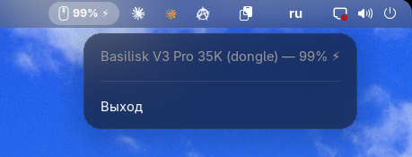

# Razer Mouse Battery Indicator — GNOME Shell Extension

Shows the battery level of a Razer wireless mouse (via the OpenRazer kernel
driver) directly in the GNOME top panel.



## Features

- Mouse icon + percentage label in the top panel, always one entry per device
- The icon is drawn from an embedded vector path and recolors itself for
  light/dark panel themes — no image assets
- Deduplication: a mouse exposes several HID battery interfaces — the
  extension selects a responding interface and reuses it on the next scan
- Dead connections (e.g. the dongle while the mouse is charging over cable)
  are hidden automatically
- ⚡ charging indicator (monochrome, follows text color)
- Sleep-aware: while the mouse sleeps (sysfs reads 0) the last known charge
  is held instead of dropping the indicator
- Low-battery notification at a configurable threshold
- One asynchronous scan at a time: 30-second polling while awake, 120 seconds
  for sleeping devices; hotplug events request a refresh after one second
- Input resumption after inactivity or switching to a Razer pointer triggers
  an immediate scan, including when input goes to another application. Native
  Mutter watches are used instead of polling the pointer or reading on every
  mouse event; bursts within five seconds are coalesced
- Disabling cancels pending work and removes all owned timers and monitors
- No background service or helper process is installed
- Driver-missing detection: if the OpenRazer kernel driver is absent, the
  indicator shows `!` and the menu offers a guided install

## Install

```bash
git clone https://github.com/bl3xand/Razer-Battery.git
cp -r Razer-Battery/battery-razer@bl3xand.dev ~/.local/share/gnome-shell/extensions/
glib-compile-schemas ~/.local/share/gnome-shell/extensions/battery-razer@bl3xand.dev/schemas
gnome-extensions enable battery-razer@bl3xand.dev
```

On Wayland, log out and back in first so GNOME Shell discovers the extension.

The `dist/` directory contains separate Git/local and extensions.gnome.org
packages. The store submission is awaiting author response; it is not an
approved listing. Its menu opens documentation and does not run an installer.
The Git/local package retains the optional terminal installer.

## Requirements

- A recent GNOME Shell

The OpenRazer kernel driver is the only dependency. It cannot be bundled
inside the extension (it is an out-of-tree kernel module), but setup is one
command — see below. If the driver is missing, the extension tells you
instead of silently failing.

## <a name="openrazer-driver"></a>OpenRazer driver

The extension reads the battery level exposed by the driver in sysfs.

**One-command install** — detects your distro, installs the driver and
adds your user to the right group:

```bash
curl -fsSL https://raw.githubusercontent.com/bl3xand/Razer-Battery/main/install-driver.sh | bash
```

What it does per distro:

| Distro | Package | Group |
|---|---|---|
| Arch (and derivatives) | `openrazer-driver-dkms` + matching kernel headers | `openrazer` |
| Fedora | `openrazer-meta` from the `hardware:razer` repo | `plugdev` |
| Ubuntu | `openrazer-driver-dkms` (universe) | `plugdev` |
| Debian | `openrazer-driver-dkms` | `plugdev` |
| openSUSE | `openrazer-driver-dkms` from `hardware:razer` | `plugdev` |

**Reboot after install** — the kernel module loads at boot, so a reboot is
required. Secure Boot may block the unsigned module; see
the [OpenRazer troubleshooting guide](https://github.com/openrazer/openrazer/wiki/Troubleshooting).

Other distros: see the [official OpenRazer instructions](https://openrazer.github.io/).

## Tested on

- Arch Linux (Razer Basilisk V3 Pro 35K)

Found a problem on your system? **Please open an
[issue](https://github.com/bl3xand/Razer-Battery/issues)** —
include your distro, GNOME Shell version and the output of
`journalctl -b /usr/bin/gnome-shell | grep battery-razer`.

## Build and check

Build both packages from one source tree:

```bash
python3 packaging/build.py
```

- `dist/battery-razer@bl3xand.dev.zip`: local/Git package, compiled settings
  schema, optional terminal installer launched only by a menu action.
- `dist/battery-razer@bl3xand.dev-store.zip`: help-only menu action, XML schema,
  no terminal installer code or compiled schema. EGO assigns its own numeric
  version. Packaging substitutes `packaging/store-actions.js` for `actions.js`.

Run the isolated checks (Node.js, GJS, GLib schema tools and Python required):

```bash
python3 tests/run.py
```

These checks use temporary files and controlled asynchronous responses. They
verify cancellation, serialized reads, disable/re-enable, hotplug coalescing,
resource cleanup and reproducible packages. They do not enable the extension
in the current session or communicate with a real mouse.

Reads still enter the OpenRazer kernel driver. Cancellation prevents further
extension work; it cannot interrupt a USB request already executing in the
kernel or guarantee that the driver itself will never hang. Earlier freezes
were not captured with a GNOME stack trace, so their exact cause remains
unconfirmed. The isolated tests are not proof of long-term desktop stability.

## Uninstall

```bash
gnome-extensions disable battery-razer@bl3xand.dev
rm -r ~/.local/share/gnome-shell/extensions/battery-razer@bl3xand.dev
```

## License

MIT
