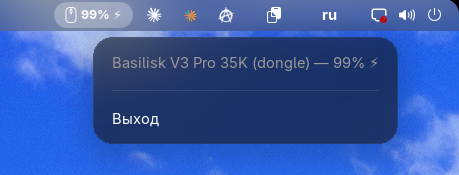

# Razer Battery Indicator — GNOME Shell Extension

Shows the battery level of Razer wireless devices (via the OpenRazer kernel
driver) directly in the GNOME top panel.



## Features

- Mouse icon + percentage label in the top panel, always one entry per device
- The icon is drawn from an embedded vector path and recolors itself for
  light/dark panel themes — no image assets
- Deduplication: a mouse exposes several HID battery interfaces — the
  extension groups them by device and takes the best nonzero reading
- Dead connections (e.g. the dongle while the mouse is charging over cable)
  are hidden automatically
- ⚡ charging indicator (monochrome, follows text color)
- Sleep-aware: while the mouse sleeps (sysfs reads 0) the last known charge
  is held instead of dropping the indicator
- Low-battery notification at 20% (configurable)
- 5 s polling, zero background processes (runs inside GNOME Shell)

## Install

```bash
git clone https://github.com/bl3xand/Razer-Battery-Indicator-Gnome-Extension.git
cp -r Razer-Battery-Indicator-Gnome-Extension/battery-razer@bl3xand.dev ~/.local/share/gnome-shell/extensions/
gnome-extensions enable battery-razer@bl3xand.dev
```

On Wayland, log out and back in first so GNOME Shell discovers the extension.

## Requirements

- OpenRazer kernel driver (`openrazer-driver-dkms`) — the extension reads
  `/sys/bus/hid/drivers/razermouse/*/charge_level` (raw 0–255, 255 = 100%)
- GNOME Shell 50 or 51

## Uninstall

```bash
gnome-extensions disable battery-razer@bl3xand.dev
rm -r ~/.local/share/gnome-shell/extensions/battery-razer@bl3xand.dev
```

## License

MIT